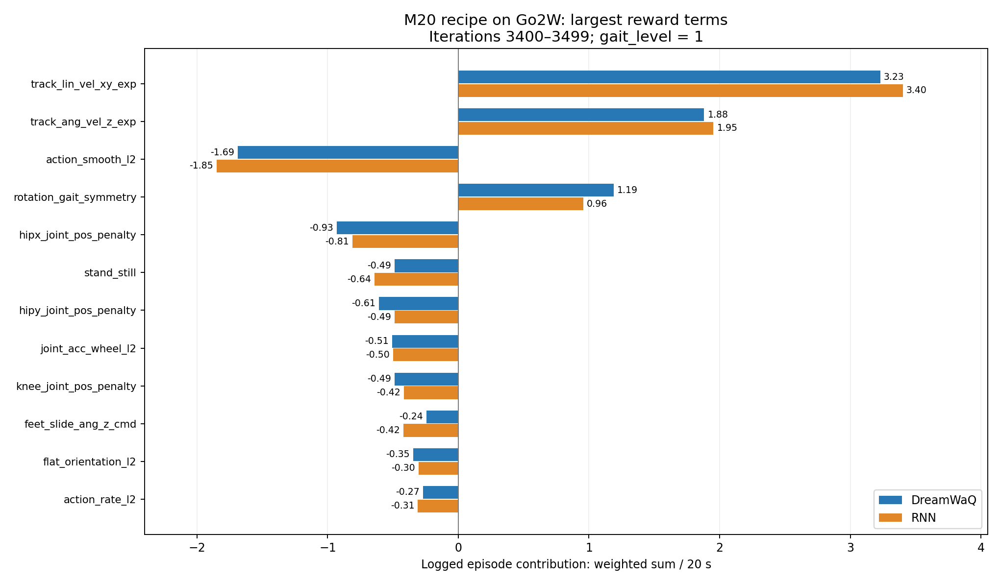

# Go2W / M20 reset 修正与奖励审查（2026-09-12）

本报告的代码修改位于 `codex/go2w-m20-env`。服务器正在运行的两路训练仍使用修正前快照；
本次未热更新或重启它们，以下曲线不能用来声称修正已改善性能。

## 已完成的物理一致性修正

### Reset 几何余量

- 原组合：root z=0.45 m，roll/pitch 各 ±0.3 rad，xy 各 ±1 m，无高度补偿。
- 对 Go2W 默认姿态的全部 27 个碰撞基元计算支持面最低点，必要时上抬 root，保留至少 0.03 m 余量。
- xy 改为 ±0.25 m，整个机器人的旋转不变碰撞包络半径约 0.51273 m，因而落在地形中心 ±0.8 m 内。
- 当前六类地形的中心平台至少 2 m，或其 origin z 是中央 2×2 m 高度上界；内侧区域还给高度场顶点修正留出余量。
- 不读取 reset 前的扫描数据；默认关节角、kp/kd 和 action/PPO 均未改变。
- 平地极端 roll=0.3、pitch=-0.3 时，旧配置最低轮缘为 -0.04518 m；新配置 root 自动提高到约 0.52518 m。
  零倾角时原有 0.45 m 高度足够，因此不额外升高。
- 不支持的地形、过小中央平台、过大出生偏移或随机化的关节 reset 会明确报错，不能假设该几何保证适用于任意新任务。

### Calf 限幅

- URDF 和 USD 的 calf 速度一致为约 20.07 rad/s；迁移任务从统一的 30 改为 calf 单独 20.07。
- hip/thigh 和轮仍为 30 rad/s。所有电机关节保留 23.5 N·m 软件力矩上限。
- URDF calf 标注 35.55 N·m，但 `deploy/policy/go2w/base.yaml` 同样使用 23.5 N·m。
  因此没有仅凭 URDF 提高力矩；这里核实的是仓库资产和部署限值，未独立测量电机实机额定参数。

### 质量与惯量的意图

明确采用 `I = I_default × (m / m_default) × s`，每个刚体独立采样一个 `s∈[0.85,1.15]`。
质量变化先影响惯量，s 表示额外建模误差。完整惯量矩阵统一缩放，保持主轴和物理惯量不等式。
每次从质量对应的基准重算，支持局部环境/刚体，不叠乘旧噪声。原先会覆盖质量重算惯量的公共函数未被改动，
新实现仅供这套迁移环境使用。

## 两个转向奖励的实际作用

`feet_slide_ang_z_cmd` 在平移命令模长 <0.1 m/s、转向命令绝对值 >0.1 rad/s 时生效。
接触条件是历史接触力最大值 >1 N。它对接触轮的 `R^T(v_foot - v_base)` 水平模长求和，乘 -2 和 gait_level。
这里是轮端刚体速度，不是轮地接触点滑移速度：没有扣除轮缘滚动速度，且没有扣除机身角速度产生的相对运动项。
因而它会把部分正常滚动分量也计入，倾向于抑制接触轮移动并配合抬轮换支撑。
比较不同策略时还受触发频率影响，数值更负不能单独推出“真实打滑更严重”。

`rotation_gait_status` 在平移命令模长 <0.5 m/s、转向命令绝对值 >0.05 rad/s 时生效。
A=(FL,RR)，B=(FR,RL)。一组两轮接触，另一组平均高度高出 5 cm 时得到 +2×gait_level。
它不要求高处那组离地、不记忆两组交替，也不检查实际转动是否完成；因此起伏地形上四轮都接触时也可能得分。
单独的 `rotation_gait_symmetry` 只约束 5 秒窗口内两组各自的平均接触占空比，仍不等于严格对角相位约束。
本次仅分析这两个奖励，没有改变其函数或权重。

## 数据口径

读取时间：2026-09-12T00:48:10.696213+08:00。两路使用相同迭代窗口 `[3400,3500)`，窗口内 gait_level 均为 1。
来源是各自恢复任务的 TensorBoard scalar 文件，不是直接比较 reward 配置中的 weight。

- DreamWaQ: `/home/sshang/omnibot_data/workspaces/OmniBot-m20-dreamwaq-rnn-20260911/locolab/logs/rsl_rl/omnibot_go2w_m20_rough_dreamwaq_v0/2026-09-11_20-51-52_m20_dreamwaq_resume_1000`
- RNN: `/home/sshang/omnibot_data/workspaces/OmniBot-m20-mlp-20260911/locolab/logs/rsl_rl/omnibot_go2w_m20_rough_v0/2026-09-11_20-51-52_m20_rnn_resume_1000`

`Episode_Reward/*` 已包含权重与 dt，按 episode 累加后除以 20 s，再被 logger 聚合。
`Train/mean_reward` 是最近若干 episode 的总回报，采样群体也不同，不能逐项直接与前者相加对照。

| Reward | DreamWaQ | RNN |
| --- | ---: | ---: |
| `track_lin_vel_xy_exp` | +3.2291 | +3.4014 |
| `track_ang_vel_z_exp` | +1.8812 | +1.9528 |
| `action_smooth_l2` | -1.6874 | -1.8500 |
| `rotation_gait_symmetry` | +1.1898 | +0.9552 |
| `hipx_joint_pos_penalty` | -0.9306 | -0.8099 |
| `stand_still` | -0.4869 | -0.6425 |
| `hipy_joint_pos_penalty` | -0.6067 | -0.4865 |
| `joint_acc_wheel_l2` | -0.5056 | -0.4972 |
| `knee_joint_pos_penalty` | -0.4855 | -0.4173 |
| `feet_slide_ang_z_cmd` | -0.2430 | -0.4186 |
| `flat_orientation_l2` | -0.3454 | -0.3037 |
| `action_rate_l2` | -0.2681 | -0.3093 |
| `feet_air_time_ang_z_M20` | -0.2368 | -0.2340 |
| `rotation_gait_status` | +0.0885 | +0.3145 |
| `ang_vel_xy_l2` | -0.1694 | -0.1707 |
| `joint_acc_l2` | -0.1320 | -0.1489 |
| `lin_vel_z_l2` | -0.1060 | -0.1213 |
| `joint_torques_l2` | -0.0344 | -0.0385 |
| `undesired_contacts` | -0.0342 | -0.0321 |
| `bad_orientation_penalty` | -0.0257 | -0.0136 |
| `contact_forces` | -0.0179 | -0.0187 |
| `joint_mirror` | -0.0082 | -0.0097 |

## 明显较大项的原因

### 1. 二阶动作平滑主要需要先排除抽样噪声的影响

窗口均值约 -1.69 / -1.85，是最大的单个负项。其权重 -0.025 比原 Go2W 的 -0.002 大 12.5 倍。
它作用于实际抽样的 16 维 action。假设策略均值固定、每步高斯噪声独立，仅噪声部分就有：

`E[||Δa||²] = 2 Σσ_i²`，`E[||Δ²a||²] = 6 Σσ_i²`。

从保存的 `model_3500.pt` 读取每一维标准差，得到以下带权噪声参考值（绝对值）：

| 模型 | mean σ | 一阶参考 | 二阶参考 |
| --- | ---: | ---: | ---: |
| dreamwaq | 0.893 | 0.271 | 2.033 |
| rnn | 0.921 | 0.290 | 2.178 |

参考值与观测量级接近，因此不能把 -1.7～-1.9 全部解释为策略均值轨迹在抖动。
这不是严格下界：实际策略均值会依赖过去动作和状态，存在反馈与相关性；episode 长度、聚合方式也有影响。
严格归因需要同条件下的确定性/随机动作对照或记录 action mean，不能据此直接修改 PPO/entropy。

### 2. 腿姿态惩罚叠加较重

stand_still + hipx + hipy + knee 的合计为 -2.510 / -2.356，比二阶动作项还大。
hipx 权重 -3，低命令且低机身速度时还会乘 5；stand_still 则只检查平移命令，纯转向时依然惩罚腿偏离默认姿态。
因此转向抬腿、高低地形适应与默认姿态约束会相互牵制。默认关节角本身已对齐；当前数据不足以把这些成本归因于某个具体关节。

### 3. 轮加速度惩罚虽权重很小，原始量并不小

该项约 -0.50，权重 1e-7。以四轮、接近完整 episode 换算，所记录轮加速度的合成口径对应每轮 RMS 约 1100 rad/s²。
保存的策略中轮子 action σ 约 1.15～1.45，乘轮速度 action scale=10 后，是约 11.5～14.5 rad/s 的目标速度噪声。
四个轮维度就占了噪声二阶差分参考贡献的约 47%。较大的速度目标噪声、轮端低惯量、接触切换及恢复系数随机化，
都能使这一项变大；目前不能仅凭 scalar 分辨各因素的贡献。

### 4. 占空比奖励较大，不等于对角转向步态已学好

rotation_gait_symmetry 约 +1.19 / +0.96，权重为 +15，达到这个量级本身不异常。
但 DreamWaQ 的 rotation_gait_status 仅 +0.088，RNN 为 +0.315；说明占空比得分和所要求的当前对角支撑状态并不等价。
在近完整 episode 的近似下，后者约对应 4.4% / 15.7% 的时间满足命令门控及状态条件。
这提示需要检查实际接触相位，不能仅据此断言策略在钻奖励漏洞。

### 5. 大 weight 不代表大实际贡献

flat_orientation 权重 -50，但实际约 -0.35 / -0.31；bad_orientation 权重 -1000，但平均只有约 -0.02。
feet_air_time 权重 +50，却长期为负（约 -0.23），说明被计入的首次落地事件总体偏向小于 0.2 s 的腾空。
其抬升阈值为 0，短暂接触切换也容易参与计分。需要腾空时间/抬升高度分布确认，不能只看权重大小。

## 训练状态的解释与下一步

该窗口内 episode 长度约 984 / 991 步（20 s 上限为 1000 步），地形等级约 5.22 / 5.40，未见数值崩溃迹象。
正项和负项已接近抵消，整体回报小不代表没有学到生存或地形通过能力。
reset/惯量修正解决物理一致性，不能保证消除上述长期正则成本。优先对 action mean 与随机 action、
静止/纯转向/行进命令分别分桶分析，再决定是否调整奖励门控或系数。本次未改 reward 权重或 PPO/action 参数。

## 验证

- 31 项 reset/MDP/配置/地形测试通过；14 项原网络、DreamWaQ、日志和视频回归测试通过。
- Black、isort、flake8 和 diff 空白检查通过。
- 本机 Isaac 独立验证：32 环境、5 组姿态、32 个 step；最小几何余量约 0.03 m，实际 calf 速度限幅 20.07 rad/s，
  惯量与质量对应基准的比例在 [0.85106,1.14987] 内，输出 `M20_RESET_NATIVE_OK`。
- 对应数值数据：`m20_reward_stats_20260912.json`。
